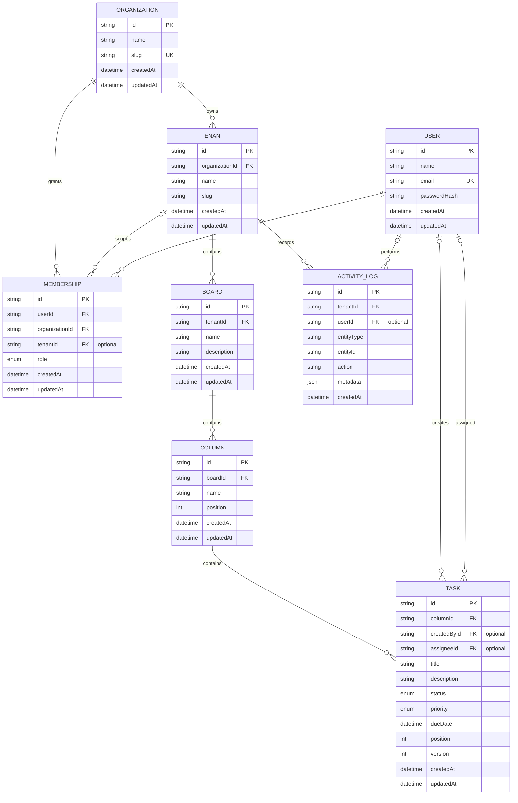

# Database ER Diagram

This diagram reflects the models and relations currently defined in
`backend/prisma/schema.prisma`.

## Tenant scope

`Task` and `Column` do not store a direct `tenantId`. Their tenant is derived
through `Task.columnId -> Column.boardId -> Board.tenantId`. API middleware
authorizes the tenant and board before task and column operations.

`Membership.tenantId` is optional: an organization-level `ORG_ADMIN`
membership has no tenant ID, while tenant-scoped memberships grant access only
to their assigned tenant. The current schema has no `TaskHistory` model;
optimistic concurrency is tracked by `Task.version`, and changes are recorded
in `ActivityLog.metadata`. A migration repairs existing position collisions
and enforces uniqueness of `(columnId, position)` for tasks.
